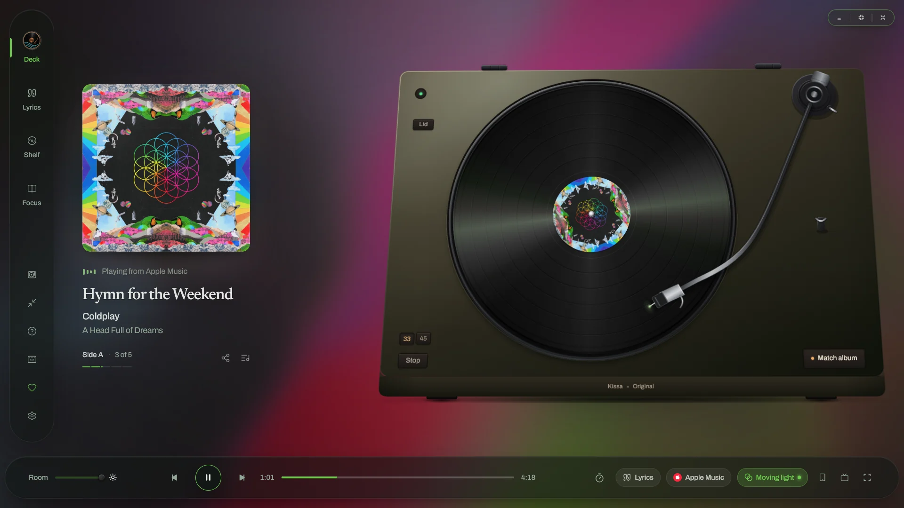
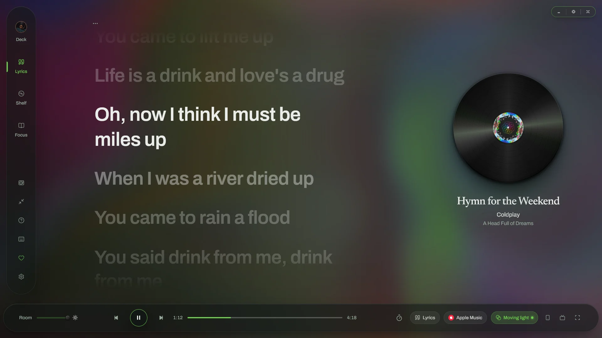
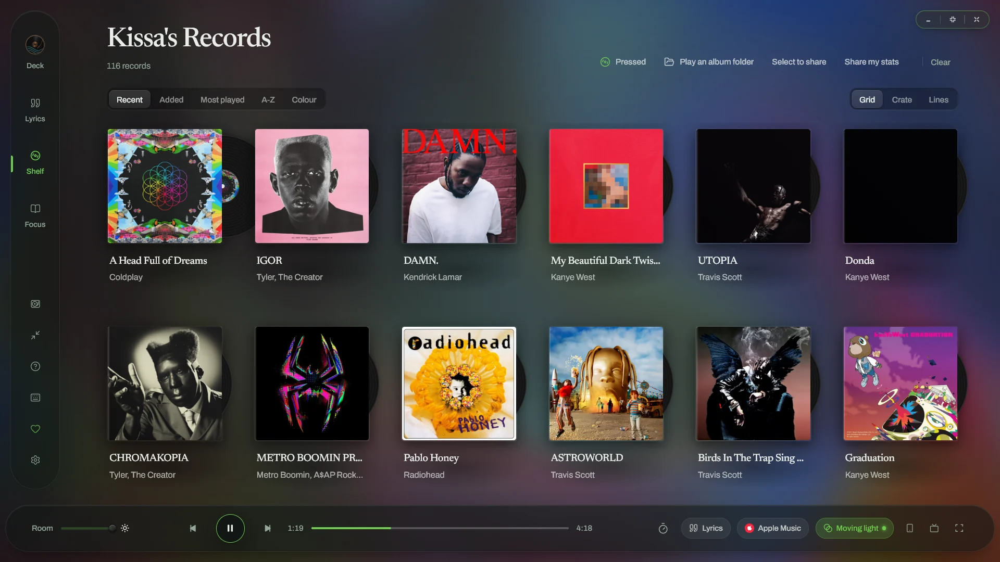
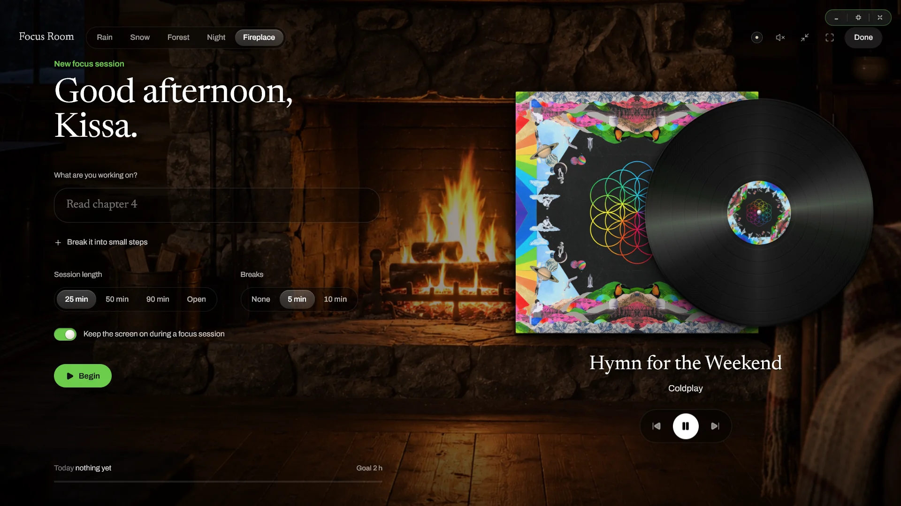
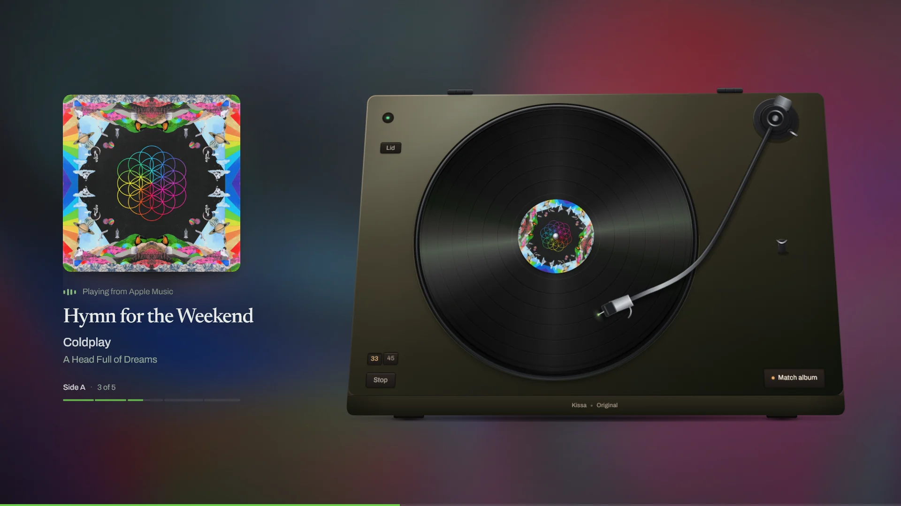

<p align="center">
  
</p>

# Kissa

### Your music keeps playing. Kissa gives the moment a room.

Kissa follows the music already playing on your Windows PC and turns the listening session into something you can settle into: a tactile turntable, a record shelf, synchronized lyrics and rooms shaped around the sound.

<a href="https://apps.microsoft.com/detail/9p3n4x4wm80j"></a>

**Free · Windows 10 and 11 · 64-bit · Version 5.1.0**

The Microsoft Store is the recommended way to install Kissa. It keeps installation and updates in one place.

<br />

**Inside this room:** [The Deck](#the-deck) · [Lyrics](#lyrics-that-follow-the-song) · [The Shelf](#a-shelf-that-remembers) · [Focus Room](#a-quieter-room-for-focus) · [Getting started](#start-with-the-music) · [For builders](#for-people-who-build-kissa)

---

## Music, with somewhere to land

Kissa takes inspiration from Japan's *jazz kissa* (ジャズ喫茶): intimate listening rooms built around music, atmosphere and time spent with a record. On Windows, it listens for the media session that is already active. Your music stays in its player; Kissa makes the space around it.

No account is needed. Open Kissa, press play in the music app you already use, and let the room come together.

## The Deck

The Deck puts the song and the turntable in the same scene. Artwork sets the mood; the record turns with playback; the tonearm follows the track. The controls stay within reach, so you can settle in without giving up the player you chose.



*The record belongs to the room. The music still belongs to your player.*

### A little more life in 5.1

The 5.1 update makes the room feel more connected and the way into it more fluid. Moving light offers **Gentle**, **Balanced** and **Lively** levels. The sound bars rest when playback pauses, and the tonearm settles onto the record and moves inward as the song plays. **Reduce motion** and **Increase contrast** are in **Settings → General**.

[Read the complete 5.1.0 release notes](https://github.com/NamanOG/Kissa/releases/tag/v5.1.0) · [See what's new on the Kissa website](https://kissa.glyphcode.studio/whats-new/)

## Lyrics that follow the song

Keep the words close while the record turns. Lyrics synchronize to the playback clock, with word progression when the source has that timing. Find another match, adjust the timing, or bring your own `.lrc` file when a song needs a different version.



*The lyrics view keeps the song, its artwork and the words together.*

Lyrics are looked up through LRCLIB. Availability and timing depend on the track and the source data.

## A shelf that remembers

The Record Shelf gathers albums from your listening history into a collection you can browse by sleeve, grid or crate. Open a record for its track list, revisit what you have played, or share a track with a link to its music service.



*A listening history with the feel of looking through a shelf of records.*

## A quieter room for focus

Step away from the bustle without stepping away from the music. The Focus Room pairs a timed sitting and small steps with a quieter scene; your record keeps turning while you work. Party mode and the full-screen Listening Display give the music more of the screen when you want to listen together or simply look up from everything else.





*A place to focus, then a full-screen room for listening.*

## The rest of the room

- **Listening environments:** Eight scenes, with **Match Album** drawing room light from the current artwork.
- **Moving light:** A room effect that can follow the music, with Gentle, Balanced and Lively intensity settings.
- **Mini player:** Keep the record and playback controls nearby in a compact window.
- **Phone remote:** Pair a phone on the same Wi-Fi with a QR code and short code; no account is needed.
- **Listening Display:** Choose a full-screen album or turntable presentation.
- **Windows screensaver:** Optionally use Kissa's native screensaver to show the Listening Display when Windows is idle.
- **Your own records:** Play albums from local folders, with optional vinyl sound, record sides, dust lid and sleeve backs.
- **Pressed:** Revisit a week, month or year of listening in a personal music story. Listening data stays on your PC.
- **Comfort controls:** Reduce motion and increase contrast in Settings → General.

---

## Start with the music

1. Install Kissa from the **[Microsoft Store](https://apps.microsoft.com/detail/9p3n4x4wm80j)**.
2. Open Kissa, then start a song in your usual music player. Kissa detects active Windows media sessions, including Spotify, Apple Music, Tidal and Chromium-based browsers.
3. Explore the Deck, open Lyrics or browse the Shelf. Use the bottom controls for playback, or select a listening environment to change the room.

Seeking and some playback controls depend on the player reporting those capabilities through Windows. Kissa is made for Windows 10 and Windows 11; other operating systems are not supported.

### A small listening-room courtesy

If Kissa has become part of your listening routine, [leave a rating or review in the Microsoft Store](https://apps.microsoft.com/detail/9p3n4x4wm80j). It helps other Windows listeners discover the app and decide if it is right for them.

<a href="https://apps.microsoft.com/detail/9p3n4x4wm80j"></a>

---

## For people who build Kissa

The Microsoft Store is the installation path for listeners. The notes below are for contributors and people building the Windows application from source.

### Stack

| Part | Technology |
| --- | --- |
| Desktop | Electron 39, React 19, TypeScript |
| Build | electron-vite, Vite 7, electron-builder |
| Windows media integration | C# .NET 10 and System Media Transport Controls |
| Screensaver | Native C# .NET 10 supervisor and Windows `.scr` protocol |
| State and motion | Zustand 5, Web Animations API, Framer Motion 12 |
| Lyrics | LRCLIB |

### Build on Windows

You will need Windows 10 or 11 (64-bit), Node.js 20 or later, npm 10 or later, and the .NET 10 SDK.

```bash
git clone https://github.com/NamanOG/Kissa.git
cd Kissa
npm install
npm run build:smtc
npm run build:screensaver
npm run dev
```

Useful checks and package commands:

```bash
npm run typecheck
npm run lint
npm run test
npm run build:win
npm run build:store
```

Windows release artifacts are written to `apps/desktop/dist/`. `build:store` creates a Store upload package; it does not publish a submission. Store installations are updated through Microsoft Store.

### How the Windows screensaver works

The optional `Kissa.scr` supervisor receives the native Windows screensaver arguments and launches `Kissa.exe --screensaver` to render the Listening Display. Registration is opt-in in **Settings → Windows Screensaver**. Kissa changes only its own `SCRNSAVE.EXE` value under the current user's registry settings; it does not change Windows' idle timeout or global screensaver activation. Unregistering Kissa leaves another selected screensaver alone.

### Known boundaries

- Media metadata and seeking depend on the active player implementing the relevant Windows System Media Transport Controls.
- Synchronized lyrics depend on LRCLIB having a suitable match for the recording.
- Kissa is built specifically for Windows because it relies on Windows media APIs and the native screensaver protocol.
- Kissa does not override Windows' screensaver timeout.

---

## Privacy, license and history

Kissa has no accounts, analytics or telemetry. It looks up lyrics and cover artwork from public services and checks GitHub for updates. Optional sharing features are described in the [privacy policy](PRIVACY.md), which lists what leaves the PC.

Kissa is free to use. Its source is published so people can read how it works; it is not open source and may not be copied or redistributed. See the [LICENSE](LICENSE).

© 2026 Naman Bagdiya · [GlyphCode](https://www.glyphcode.studio/)

<details>
<summary>Earlier versions</summary>

- **5.0.0: A new way to listen.** Pressed listening stories, phone remote, local albums, Party mode, Listening Display, mini player and sleep timer. [Release notes](https://github.com/NamanOG/Kissa/releases/tag/v5.0.0)
- **4.4.0: Your turntable.** Turntable finishes and pressings, Record Crate, refined controls and settings. [Release notes](https://github.com/NamanOG/Kissa/releases/tag/v4.4.0)
- **4.3.1: Maintenance.** More reliable media detection, artwork and lyrics handling, plus a lighter Deck.
- **4.3.0: The Study Room.** Focus sessions, rooms, session review, sharing options and improvements across the Shelf and lyrics.
- **4.2.0: The Front Door.** Microsoft Store build, setup preferences, a smaller package, lyrics refinements and accessibility settings.
- **4.1.0: The Deliberate Listening Update.** Native screensaver, Listening Display, external seeking and in-app updates.
- **4.0.0: The Listening Machine.** Redesigned turntable, Record Shelf, synchronized lyrics and mini player.
- **3.0.1: The Room Responds.** Match Album atmosphere, artwork-driven light and playback synchronization refinements.
- **3.0.0:** Unified playback architecture, vinyl animation and listening environments.
- **1.0.0:** First release with turntable interface, Windows media synchronization and lyrics.

</details>
