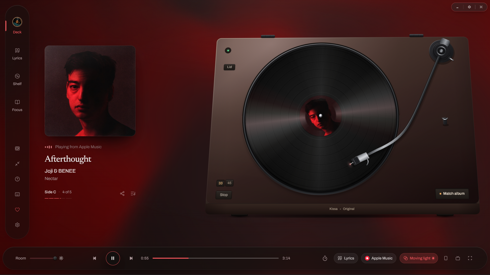
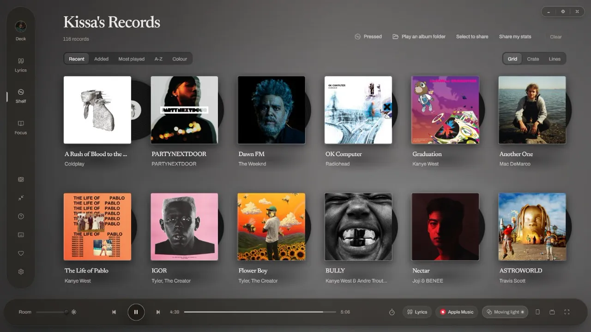
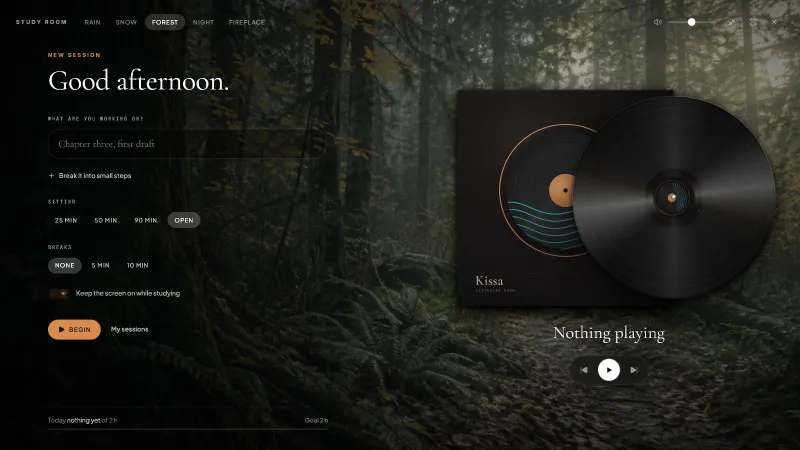

<div align="center">
  

  <h1>Kissa</h1>

  <p><strong>A listening room for the music already playing on your Windows PC.</strong></p>
  <p>Keep listening where you are. Kissa takes care of the room.</p>

  <a href="https://apps.microsoft.com/detail/9p3n4x4wm80j">
    
  </a>

  <p><sub>Version 5.1.0 &nbsp;·&nbsp; Free for Windows 10 and 11 (64-bit)</sub></p>
</div>

<p align="center">
  
</p>

<p align="center"><sub>THE DECK &nbsp;·&nbsp; A live Windows music session, brought into the room</sub></p>

<p align="center">
  <a href="#whats-new-in-510">The 5.1 update</a> &nbsp;·&nbsp;
  <a href="#the-listening-room">Explore the room</a> &nbsp;·&nbsp;
  <a href="#getting-started">Get started</a> &nbsp;·&nbsp;
  <a href="#development--building">Build Kissa</a>
</p>

---

## Music has a place here

Kissa is inspired by Japan's *jazz kissa* (ジャズ喫茶): intimate rooms built around attentive listening, analog warmth and atmosphere. It follows the music already playing on your PC, then gives that listening session a turntable, a shelf, synchronized lyrics and a room that can move with the album.

Your music stays in its player. Kissa brings the listening room around it.

## What's new in 5.1.0

The new version gets out of the way sooner and makes the room feel more connected to the music.

**A smoother arrival.** Kissa opens directly into its introduction, with more fluid page changes, song transitions and Focus Room entry.

**A room that listens.** Moving light now has **Gentle**, **Balanced** and **Lively** settings. Sound bars rest when playback pauses; the tonearm settles on the record and tracks inward as a song plays.

**A calmer finish.** Minimise, maximise and close sit together in a compact control capsule. **Reduce motion** and **Increase contrast** are available in **Settings → General**.

[Read the full 5.1.0 release notes](https://github.com/NamanOG/Kissa/releases/tag/v5.1.0) &nbsp;·&nbsp; [See what's new on the Kissa website](https://kissa.glyphcode.studio/whats-new/)

---

## The Listening Room

The Deck is where a listening session begins: album art sits beside a turning record, the tonearm moves with playback, and controls stay close without getting between you and the music.

<p align="center">
  <a href="./apps/website/public/media/modes/shelf.webp"></a>
  <a href="./apps/website/public/media/study/study-forest-800.webp"></a>
</p>

<p align="center"><sub>THE SHELF &nbsp;·&nbsp; Browse the records that shaped your listening</sub><br /><sub>THE FOCUS ROOM &nbsp;·&nbsp; Make space for one thing at a time</sub></p>

The **Record Shelf** keeps your listening history close, with album views and crate-style browsing. **Listening rooms** shift between eight considered settings, or let **Match Album** draw its light from the artwork. For quieter work, the **Focus Room** pairs a timed sitting and small steps with the record still turning.

Lyrics follow the playback clock, with line-level timing, word progression when the source allows it, and controls to find or correct a match. When you want less between you and the music, use the full-screen Listening Display, mini player, native screensaver or phone remote on the same Wi-Fi.

<details>
<summary>Explore all features</summary>

### Physical Turntable

- Hardware-inspired turntable with realistic depth and lighting
- Vinyl rotation at 33 ⅓ RPM and 45 RPM, with rotational phase preserved across pauses and track changes
- Physical tonearm placement, needle-drop response and real-time seeking through the record groove
- Tactile rotary dials and hardware switches for speed and power

### Windows System Media Integration

- Native Windows System Media Transport Controls (SMTC) synchronization
- Automatic session detection for Spotify, Apple Music, Tidal and Chromium-based browsers
- Bidirectional Play, Pause, Previous and Next controls
- External seeking through SMTC (`TryChangePlaybackPositionAsync`) where the player supports it
- Accurate UTF-8 metadata and a playback clock that reconciles timing drift
- System tray background operation with quick playback access

### Synchronized Lyrics

- Real-time lyric synchronization powered by LRCLIB
- Word-level progression where source LRC data permits
- Instrumental break indicators and countdowns
- Per-track timing offset calibration (-5.0s to +5.0s)
- Click-to-seek from lyric lines and smooth scrolling with manual scroll recovery

### Listening Environments & Match Album

Eight listening environments: **Quiet Listening Room**, **Dusty Record Store**, **Japanese Jazz Bar**, **Midnight Apartment**, **Rainy Window**, **Hi-Fi Library**, **Concrete & Vinyl** and **Sunday Morning**. **Match Album** uses the dominant and accent colours in the current artwork to shape the room's light.

### Focus Room, Party Mode & Phone Remote

- Timed Focus Room sittings, small steps and a quieter place to work while the record keeps turning
- Party mode and Listening Display for full-screen listening; a mini player keeps the record and controls close
- Pair a phone over the same Wi-Fi with a QR code and short code; no account is needed

### Listening Display & Native Screensaver

- Full-screen Listening Display with a 12-inch album stand or turntable presentation
- Native Windows screensaver (`Kissa.scr`) that activates during Windows idle periods
- Optional registration that sets `SCRNSAVE.EXE` without changing Windows timeout policies
- Settings shortcut to the Windows Screen Saver control panel
- Clean exit on mouse movement, keyboard input or touch

### Record Shelf & Crate Browsing

- Album catalog with grid, crate and spine views
- Sort by Recently Played, Recently Added, Play Count, Alphabetical or Colour
- Album inspection with full track listings and metadata
- Share tracks with links for Spotify, Apple Music, Tidal and YouTube, or as clean text citations

### Startup, Setup & Updates

- Interactive first-run setup for RPM, listening environment and display preferences
- In-app update checks with download progress, cancellation and an explicit install confirmation
- Installed updates hand off to the NSIS installer; portable updates are saved to Downloads for the user to launch
- Update checks and install handoffs are suppressed in screensaver mode

</details>

---

## Download & Installation

For the simplest install and automatic updates, **get Kissa from the Microsoft Store**.

<p align="center">
  <a href="https://apps.microsoft.com/detail/9p3n4x4wm80j">
    
  </a>
</p>

If Kissa has found a place in your listening routine, [leave a rating and review in the Microsoft Store](https://apps.microsoft.com/detail/9p3n4x4wm80j). Your feedback helps other listeners decide whether it belongs in theirs.

---
## Windows Screensaver Architecture

Kissa includes a dedicated Windows screensaver implementation that renders the full-fidelity **Listening Display** when invoked by Windows.

### How It Works

1. **Supervisor (`Kissa.scr`):** A lightweight C# .NET 10 native Windows executable that receives Windows screensaver arguments (`/s`, `/c`, `/p`). On `/s`, it spawns `Kissa.exe --screensaver` and waits for the child process to terminate.
2. **Renderer (`Kissa.exe --screensaver`):** Electron initializes directly into the `ListeningDisplay` component with user chrome stripped. Audio hooks listen for wake input (mouse movement exceeding threshold, key press, or click) and exit cleanly.
3. **Safe Registry Management:** Screensaver registration is strictly opt-in via **Settings → Windows Screensaver**:
   - Updates `HKCU\Control Panel\Desktop\SCRNSAVE.EXE`.
   - Never alters system timeout (`ScreenSaveTimeOut`) or global screensaver activation state (`ScreenSaveActive`).
   - Conditional unregister only removes the value if it currently points to `Kissa.scr`, leaving other screensavers untouched.
   - Built-in "Open Windows Screensaver Settings" button launches `control.exe desk.cpl,,@screensaver` to let users adjust Windows idle timeout natively.

---

## Usage Guide

### Getting Started

1. Launch Kissa. If you are launching for the first time, the onboarding dialog lets you choose your default turntable speed and listening environment.
2. Open your preferred music player (Spotify, Apple Music, Tidal, or browser). Start playing a song.
3. Kissa detects the active Windows media session within seconds, displaying the album artwork, track details, and starting vinyl rotation.

### Turntable Controls

- **Power Switch:** Toggle turntable motor on or off.
- **33 ⅓ / 45 RPM Switch:** Switch rotational velocity.
- **Tonearm:** Click and drag the tonearm across the record surface to seek through the active track (supported players).
- **Transport Controls:** Use the bottom dock for Play/Pause, Next, Previous, and volume adjustments.

### Listening Display & Screensaver

- Press the **Display** button in the dock (or press `F11`) to enter the manual Listening Display. Press `Esc` or move your mouse to exit.
- Toggle between **Turntable Mode** and **Album Art Mode** using the top display selector.
- To use Kissa as your automatic screensaver, open **Settings (gear icon) → Windows Screensaver → Set as Windows Screensaver**, then click **Open Windows Screensaver Settings** to configure your preferred idle timeout in Windows.

### Synchronized Lyrics

- Click the **Lyrics** button in the dock or press `L` to toggle the lyrics drawer.
- If the lyrics are wrong or missing, open **Lyrics options**. Search for another LRCLIB match, or import/drop a UTF-8 `.lrc` file smaller than 256 KB. The choice stays with this recording on this PC; **Use automatic lyrics** removes it.
- If lyrics appear slightly ahead of or behind external audio, use the `+` / `-` offset buttons in the lyrics panel to calibrate timing in 250ms increments.

### In-App Updates

- Open **Settings (gear icon) → Application → Check for Updates** (or right-click the system tray icon and select **Check for Updates...**).
- If a new version is available, Kissa displays the release version and a **Download Update** button.
- Click **Download Update** to stream the release binary directly within the app. A real-time progress bar reports transfer percentage, download speed, and transferred megabytes, with a **Cancel** button if you wish to abort.
- **Installed Version:** Once the download completes, click **Restart & Install**. Kissa prompts for confirmation (*"Restart Kissa now to apply update? Active playback will stop."*) before closing cleanly and handing off to the NSIS installer.
- **Portable Version:** Kissa downloads the new portable executable to your Windows Downloads folder and presents a **Show in Folder** button so you can launch the updated binary at your convenience without risking in-place executable corruption.
- **Safe Fallbacks:** If a download is interrupted or encounters network errors, click **Try Again** or use **View Release** to view release notes directly on GitHub.
- **Screensaver Guard:** Update checks and installation handoffs are strictly suppressed while Kissa is running in native screensaver mode (`--screensaver`).

---

## Technical Architecture

| Layer | Technology | Purpose |
| --- | --- | --- |
| **Desktop Shell** | Electron 39 | Windows desktop lifecycle, native window management, multi-process IPC |
| **Build Tooling** | `electron-vite` / Vite 7 | Fast development HMR and production bundling |
| **User Interface** | React 19 + TypeScript | UI component architecture and strict type safety |
| **Native SMTC Helper** | C# .NET 10 (`smtc-helper.exe`) | WinRT `Windows.Media.Control` integration for external media discovery and seeking |
| **Screensaver Supervisor** | C# .NET 10 (`Kissa.scr`) | Native Windows screensaver protocol bridge (`/s`, `/c`, `/p`) |
| **State Management** | Zustand 5 | Application state, player store, and user preferences |
| **Styling** | TailwindCSS v3 + CSS Variables | Hardware design system, typography tokens, and atmospheric themes |
| **Motion & Animation** | Web Animations API + Framer Motion 12 | Smooth 60 FPS vinyl rotation, tonearm physics, and UI transitions |
| **Lyrics Engine** | LRCLIB API | Synchronized timestamped lyric retrieval |
| **Packaging** | `electron-builder` + NSIS | Windows installer and portable binary generation |

---

## Known Limitations

- **External Application SMTC Support:** Kissa relies on the active media player's implementation of Windows SMTC. While playback status and track metadata work consistently across Spotify, Apple Music, and Chromium browsers, some desktop media applications do not report playback timeline positions or implement seek commands.
- **Seeking Capabilities:** Seeking via tonearm or progress scrub bar depends on whether the source application implements `TryChangePlaybackPositionAsync`. Spotify Desktop and modern browsers support this; certain legacy players do not.
- **Platform Scope:** Kissa is engineered exclusively for Windows 10 and Windows 11 to take full advantage of native Windows Media Control APIs and `.scr` screensaver protocols.
- **Windows Idle Timeout:** Kissa cannot and does not programmatically override your Windows global screensaver timeout. Windows controls when screensavers activate based on the duration configured in Windows Screen Saver Settings.
- **Lyrics Availability:** Synchronized lyrics are sourced from the public LRCLIB database. Rarely played tracks, instrumental compositions, or local un-tagged files may not have synchronized lyrics available.

---

## Development & Building

The commands below are for people building or maintaining Kissa. For a normal installation, use the Microsoft Store link above so the Store can install and update the app.

### Prerequisites

- Windows 10 or Windows 11 (64-bit)
- Node.js `>= 20.0.0`
- npm `>= 10.0.0`
- .NET 10 SDK (required to compile the current `smtc-helper` and `KissaScreensaver` projects)

### Local Setup

```bash
# Clone the repository
git clone https://github.com/NamanOG/Kissa.git
cd Kissa

# Install dependencies
npm install

# Build the bundled Windows helpers before the first development run
npm run build:smtc
npm run build:screensaver

# Start development mode
npm run dev
```

### Verification Commands

```bash
# Type checking
npm run typecheck

# Code linting
npm run lint

# Automated test suite
npm run test

# Build native SMTC helper
npm run build:smtc

# Build native Windows screensaver
npm run build:screensaver

# Build unpacked Windows distribution
npm run build:unpack
```

### Production Build

```bash
# Build Windows installer and portable packages for release validation
npm run build:win

# Build the separate Microsoft Store upload package (does not publish)
npm run build:store
```

Production artifacts are output to `apps/desktop/dist/`:

- `Kissa-Setup-5.1.0.exe`
- `Kissa-Portable-5.1.0.exe`

---

## Version History

### v5.1.0 — A smoother listening room

- Opens straight into the introduction, with smoother page changes, song transitions, and Focus Room entry.
- Adds Gentle, Balanced, and Lively Moving light settings, sound-reactive bars, and a tonearm that settles and tracks playback.
- Adds Reduce motion and Increase contrast options in Settings → General.
- [Full release notes](https://github.com/NamanOG/Kissa/releases/tag/v5.1.0)

### v5.0.0 — A new way to listen

- Pressed turns your week, month, or year in music into a moving story with a share card. Listening data stays on your PC.
- Control Kissa from your phone on the same Wi-Fi, with a QR code and 6-digit code. No account is needed.
- Play your own album folders with optional vinyl sound, a dust lid, record sides, and sleeve backs.
- Adds Party mode, Listening Display, a record-only mini player, room-light controls, and a sleep timer.
- [Full release notes](https://github.com/NamanOG/Kissa/releases/tag/v5.0.0)

### v4.4.0 — Your turntable

- **Your turntable (Kissa Editions):** Choose a finish (Original walnut, Porcelain satin lacquer or brushed Studio Silver with black anodised controls) and a record pressing, then save the looks you like. Open it from the sidebar, the nameplate on the deck, Settings, or the E key.
- **Special pressings:** Green, Oxblood and Midnight Marble, Tortoiseshell and Splatter alongside the plain colours. The Focus Room has its own record picker.
- **The Record Crate:** Flip through your Shelf like a crate of records, one sleeve at a time, with the mouse wheel or arrow keys.
- **Crisper controls:** The power switch, speed keys, Start/Stop, Match Album and the needle have short mechanical sounds modelled on real parts.
- **A calmer, clearer Kissa:** Redesigned Settings, one family of switches and buttons, and two typefaces (Newsreader and Archivo) used with clear roles.
- **Smoother track changes:** With Match the album, changing songs no longer makes the app stutter. An optional Moving light lets the album colours drift slowly behind the room.
- **Support Kissa:** A link on the Deck and in Settings opens a page on Kissa's website for anyone who wants to help. Kissa stays completely free, with nothing locked.

### v4.3.1 — Maintenance

- **Covers Stay With Their Song:** Some players report a new song a few seconds before its picture. Kissa no longer keeps the previous song's cover for the rest of the track, or remembers that picture as the new song's cover.
- **Media Detection Recovers:** If Kissa's background media reader stops, it now restarts on its own (up to three times in ten minutes) instead of leaving playback untracked until Kissa is reopened.
- **Less Repeated Work:** A cover search that finds nothing, or fails while offline, is no longer repeated every second, and the in-memory cover cache stays within its limit during long sessions.
- **Lighter Deck:** A background layer that had no visible effect has been removed. While a song plays with the Deck on screen, Kissa now uses noticeably less processor time.
- **Local Diagnostics:** A small file on your PC records crashes and freezes by event name and code only. Nothing is uploaded.

### v4.3.0 — The Study Room

- **Study Room:** A full-window place to work with your record still turning. Four rooms (Rain, Snow, Forest, Night) are photographs with living weather on top, each with its own CC0 field recording and a volume slider. Set an intention and small steps, choose sittings and breaks, park stray thoughts, and review the session at the end. The clock survives sleep and restarts, and the screensaver waits while a session is running.
- **Share on Discord:** Optional, off by default. Shows the Apple Music track on your Discord profile with its cover, a time bar, Kissa's badge and a Store link. Spotify can be shared too through a separate switch.
- **Lyrics That Arrive:** Lyrics lookups now survive LRCLIB throttling and slow responses, reject results for the wrong song, and remember lyrics already found so a replay shows them at once.
- **Lyrics Recovery:** Choose another recording or import an LRC file, with a local choice remembered separately from the provider cache.
- **Share a Sitting:** Preview a portrait or square card from the Study Room review, then copy or save it. It shows the room, focus minutes, step counts and the record at the finish, leaving your intention and notes private.
- **Shelf Cover Repair:** Old album covers refresh from the current player's verified artwork without adding extra listens for cover or progress updates.
- **Study on Discord:** While a session runs, your Discord profile can show the room and its timer (never what you are working on), with a link to Kissa.
- **Your Week:** My sessions shows the last seven days against your daily goal, with a streak.
- **Lighter and Smoother:** On 120 and 144 Hz screens the record turns in 60 steps a second and nothing wakes the window faster than it can show; line-timed lyrics no longer repaint every frame; progress bars and the tonearm redraw only when they move. The Deck uses about a quarter of the processor time it did.
- **A Bigger Record in the Study Room:** The record and sleeve grow with the window, and the setup fits small windows.
- **Kissa's Own Sleeve:** The idle cover and record label are drawn from Kissa's logo.
- **The Fireplace Room:** A fifth Study Room: a cabin hearth whose flames sway, surge and throw sparks, with a real fire recording.
- **Covers That Match Your Player:** Kissa keeps your player's own cover and only swaps in a sharper catalogue copy when it is the same picture (albums such as HEROES & VILLAINS have different art on different services).
- **A New Opening:** Kissa's mark assembles itself when the app opens.
- **Steadier Record:** Light and shadow no longer turn with the record, so it reads as a true circle.
- **Share, Redone:** A clearer share dialog whose message links to Kissa on the Microsoft Store; a richer stats card; a record view on the Shelf lit by its cover.
- **Updates in the Store Build:** Kissa tells you when the Microsoft Store has a newer version and opens the Store to update.
- **Privacy:** `PRIVACY.md` covers Discord sharing, Study Room data and the website's cookieless visit counts.

### v4.2.0 — The Front Door

- **Microsoft Store Build:** Kissa can now be packaged for the Microsoft Store (`npm run build:store`) alongside the existing installer and portable builds. The Store build registers its screensaver from a stable per-app location, starts at sign-in through a Windows startup task, and leaves updates to the Store.
- **Start with Windows & Keep Running in Tray:** Both preferences now have switches in Settings. They were stored and honoured before, but nothing exposed them.
- **Far Smaller Download:** The app archive no longer ships .NET build output or build-only tooling, cutting it from about 546 MB to about 16 MB.
- **Honest Record Shelf:** The idle "Kissa — Listening Room" placeholder is no longer saved as an album, and is removed from existing shelves.
- **Lyrics When Idle:** With nothing playing, the lyrics view shows "Waiting for Music" instead of searching for lyrics to the placeholder.
- **Lyrics That Stay in Time:** The clock the lyrics follow was being rounded to the nearest second once a second, leaving them up to half a second out for a whole track. It now runs free between reports from the music app and eases out drift. Word-by-word highlighting was also reading the wrong word's timing; that is fixed.
- **The Right Lyrics for the Recording:** Timed lyrics are only used when they belong to the same cut of the song. When only another version's lyrics exist, the words are shown without timing instead of drifting. Results for a different song are ignored.
- **Lighter on the Machine:** The media helper sent the full album cover five times a second. It now sends the cover once and a small heartbeat after that, and the lyrics view no longer redraws every line on every line change.
- **Make It Yours:** Choose the colour of the record (seven pressings), tell Kissa your name for a greeting and your shelf's title, and set the lyrics' size and typeface.
- **Tidier Deck and Settings:** The deck shows the album, and no longer repeats the time three times. Settings are split into Room, Playback and System. Timing can be nudged from the lyrics view itself.
- **Works Offline:** Every typeface now ships inside the app; nothing is fetched from a font server.
- **Adaptive Atmosphere Tile:** The ninth atmosphere has its own artwork instead of repeating the Warm Walnut Studio photograph.
- **Minimum Window Size:** Raised to 900 × 640, the smallest size at which the deck layout fits without overlap.
- **Licence & Privacy:** Kissa stays free to use, and from this version the source is published for reading rather than reuse (see `LICENSE`). Added `PRIVACY.md`.

### v4.1.0 — The Deliberate Listening Update

- **External SMTC Seeking:** Real-time bidirectional seeking through Windows System Media Transport Controls via `TryChangePlaybackPositionAsync` with optimistic clock settlement.
- **Native Windows Screensaver:** Bundled `Kissa.scr` supervisor with safe HKCU user registration and unregistration.
- **Listening Display:** A larger 12-inch album display, centered type, room lighting, and one view shared by manual and screensaver modes.
- **Windows Screensaver Settings Shortcut:** Direct button in application settings to open Windows Screen Saver control panel (`control.exe desk.cpl,,@screensaver`).
- **Synchronized Lyrics Improvements:** Instrumental break countdowns, fine-grained offset adjustment (-5.0s to +5.0s), and click-to-seek navigation.
- **Source-Aware Track Sharing:** Contextual modal generating direct links for Spotify, Apple Music, Tidal, and YouTube.
- **Hardware Setup Onboarding:** Interactive first-run setup flow for initial turntable and room personalization.
- **In-App Update System:** Safe, user-controlled update checking, in-app streaming download with real-time transfer progress, cancellation support, confirmation dialogs, and clean installer handoff (with separate safe handling for portable builds).
- **Production Polish:** Clean production updater diagnostics gating, zero-warning Tailwind build, and complete test coverage across 38 suites.

### v4.0.0 — The Listening Machine

- Redesigned Listening Room and turntable interaction
- Archival Record Shelf with crate browsing
- Cinematic synchronized lyrics
- Refined Match Album environments
- Hardware-inspired controls
- System Media Transport Controls synchronization
- Mini Player companion

### v3.0.1 — The Room Responds

- Match Album adaptive atmosphere
- Artwork-driven ambient lighting
- Playback duration synchronization improvements
- Tonearm and lyric adjustments

### v3.0.0

- Unified playback architecture
- High-performance vinyl animation
- Dedicated Mini Player
- Listening environments

### v1.0.0

- Initial Kissa release featuring turntable interface, SMTC synchronization, and synchronized lyrics.

---

## License

Kissa is free to use. The source is published so you can see how it works; it is not open source and may not be copied or redistributed. See [LICENSE](LICENSE).

© 2026 Naman Bagdiya ([GlyphCode](https://www.glyphcode.studio/))

## Privacy

Kissa has no accounts, analytics or telemetry. It looks up lyrics and cover artwork from public services and checks GitHub for updates; [PRIVACY.md](PRIVACY.md) lists exactly what is sent.
