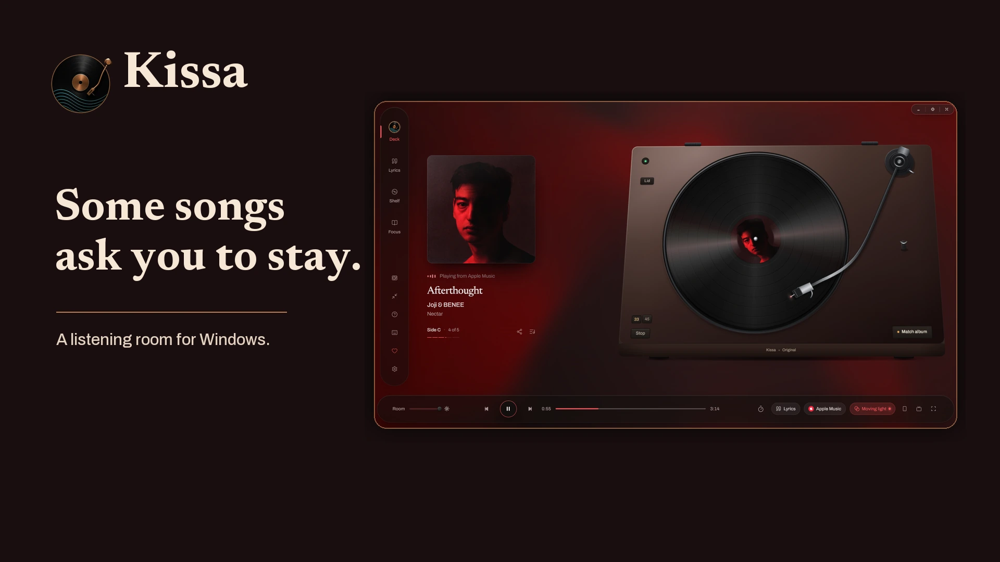
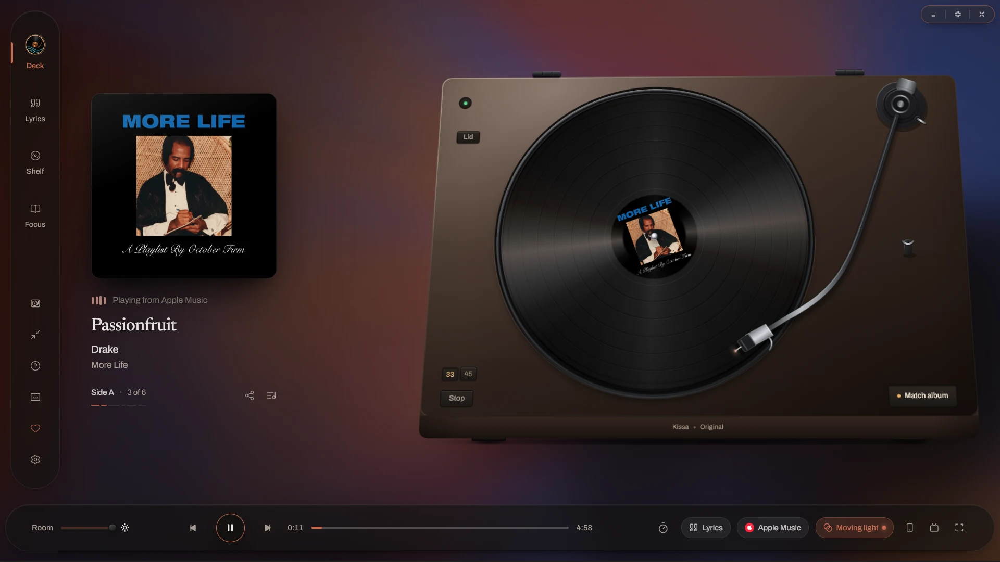
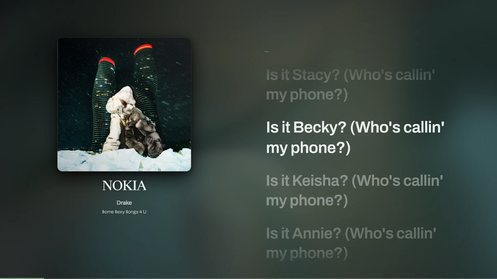
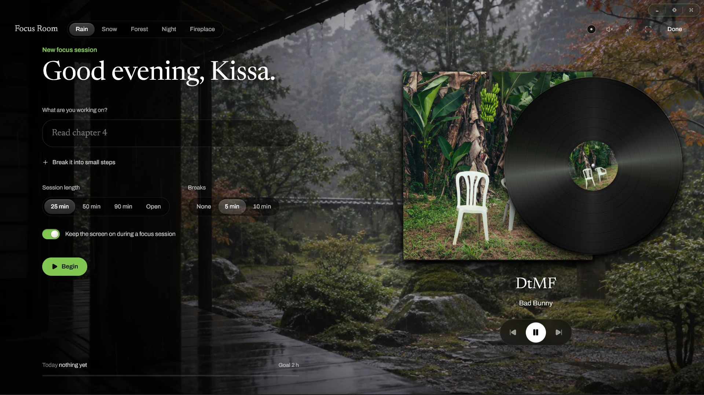
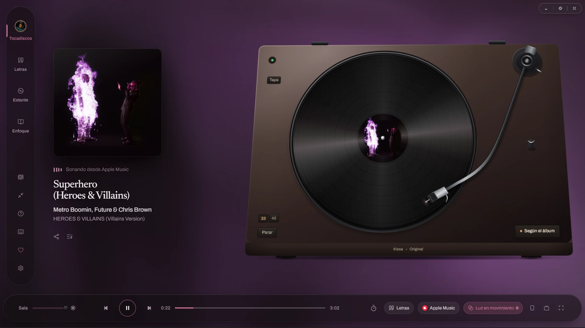

<p align="center">
  
</p>

# Kissa

### Stay for the song that's already on.

Kissa takes its name from Japan's jazz kissa: listening cafés where you sit with a record and simply listen. We carried that feeling into a Windows listening room. The song begins in the player you already use; Kissa gives the moment somewhere to settle.

Open the room, start your music in the player you already use, and let the album find its color. The sound stays with your player while Kissa follows the active Windows media session.

<a href="https://apps.microsoft.com/detail/9p3n4x4wm80j"></a>

**Free for Windows 10 and 11 · 64-bit · Version 5.1.0**

The Microsoft Store is the recommended place to install Kissa and receive updates. If the room becomes part of your listening ritual, leave a [rating or review in the Microsoft Store](https://apps.microsoft.com/detail/9p3n4x4wm80j) to help another listener find it.

---

## The room takes its color from the record

One evening it's *Passionfruit*. The sleeve becomes the center of the scene; Match Album brings its palette into the room while Moving light follows the music. Choose Gentle, Balanced or Lively when you want more or less movement.



*“Passionfruit” by Drake, from **More Life**. The room follows a different record, and the palette changes with it.*

## Some nights are made of words

The song stays in view as the lyric line comes forward. Kissa follows the playback clock, with word progression when the recording has word-level timing. Search for a better match, adjust the timing, or bring your own `.lrc` file when the words need help finding their place.



*“Nokia” by Drake, from **$ome $exy $ongs 4 U**. Lyrics are looked up through LRCLIB; availability and timing depend on the recording and its source data.*

## Then let the day get quieter

The Focus Room leaves space for a timed sitting, a few small steps, and the song that brought you there. Choose a scene, set the length, and work while the record remains in view.



*“DtMF” by Bad Bunny. A little green in the room, a little time for yourself.*

## Every record brings another room

The same deck can feel entirely different from one album to the next. Here, “Superhero” spills violet light across the turntable; album art, tonearm and playback stay together in the scene.



*“Superhero” by Metro Boomin, Future and Chris Brown, from **Heroes & Villains**.*

The Record Shelf keeps the albums you've heard close by, ready to browse as sleeves, a grid, or a crate. **Pressed** turns a week, month or year of listening into a personal story. For a quieter screen, open the mini player or the full-screen Listening Display; pair the phone remote on the same Wi-Fi when you want playback controls in hand.

## In 5.1, the room listens more closely

The latest update gives Kissa a smoother arrival and more composed transitions between pages and songs. Moving light now has **Gentle**, **Balanced** and **Lively** settings. Sound bars rest when playback pauses; the tonearm settles onto the record and tracks inward as the song plays. **Reduce motion** and **Increase contrast** live in **Settings → General**.

[Read the full 5.1.0 release notes](https://github.com/NamanOG/Kissa/releases/tag/v5.1.0) · [See what's new on the Kissa website](https://kissa.glyphcode.studio/whats-new/)

---

## Make a little room

1. Install Kissa from the **[Microsoft Store](https://apps.microsoft.com/detail/9p3n4x4wm80j)**.
2. Open Kissa, then play a song in Apple Music, Spotify, Tidal or a Chromium-based browser.
3. Come back to the Deck. Browse the Shelf, open Lyrics, or choose a listening environment that suits the hour.

Kissa works with Windows media sessions. Playback details and seeking depend on what the active player reports through Windows. Lyrics depend on LRCLIB finding a suitable match. Kissa is made for Windows 10 and 11.

### If you've been listening awhile

Take a moment to [rate or review Kissa in the Microsoft Store](https://apps.microsoft.com/detail/9p3n4x4wm80j). Your note can help another Windows listener decide if this room is for them.

<a href="https://apps.microsoft.com/detail/9p3n4x4wm80j"></a>

---

## Notes from the listening room

Kissa has no accounts, analytics or telemetry. It looks up lyrics and cover artwork from public services and checks GitHub for updates. Optional sharing features and their data use are described in the [privacy policy](PRIVACY.md).

Kissa is free to use. The source is published so people can see how it works; it is not open source and may not be copied or redistributed. See the [LICENSE](LICENSE).

© 2026 Naman Bagdiya · [GlyphCode](https://www.glyphcode.studio/)

<details>
<summary>For people who build Kissa</summary>

The Microsoft Store is the installation path for listeners. These notes are for contributors building the Windows app from source.

### The cabinet

| Part | Technology |
| --- | --- |
| Desktop | Electron 39, React 19, TypeScript |
| Build | electron-vite, Vite 7, electron-builder |
| Windows media integration | C# .NET 10 and System Media Transport Controls |
| Screensaver | Native C# .NET 10 supervisor and Windows `.scr` protocol |
| State and motion | Zustand 5, Web Animations API, Framer Motion 12 |
| Lyrics | LRCLIB |

### Build on Windows

Requirements: Windows 10 or 11 (64-bit), Node.js 20 or later, npm 10 or later, and the .NET 10 SDK.

```bash
git clone https://github.com/NamanOG/Kissa.git
cd Kissa
npm install
npm run build:smtc
npm run build:screensaver
npm run dev
```

Run the checks and create Windows builds with:

```bash
npm run typecheck
npm run lint
npm run test
npm run build:win
npm run build:store
```

Release packages are written to `apps/desktop/dist/`. `build:store` creates a Store upload package; it does not publish a submission. Store installations receive updates through Microsoft Store.

### The Windows screensaver

The optional `Kissa.scr` supervisor receives the Windows screensaver arguments and launches `Kissa.exe --screensaver` to show the Listening Display. Registration is opt-in in **Settings → Windows Screensaver**. Kissa changes only its own `SCRNSAVE.EXE` value for the current user. It does not change Windows' idle timeout or global screensaver activation, and unregistering Kissa leaves another selected screensaver alone.

</details>

<details>
<summary>Earlier chapters</summary>

- **5.0.0:** Pressed listening stories, phone remote, local albums, Party mode, Listening Display, mini player and sleep timer. [Release notes](https://github.com/NamanOG/Kissa/releases/tag/v5.0.0)
- **4.4.0:** Turntable finishes and pressings, Record Crate, refined controls and settings. [Release notes](https://github.com/NamanOG/Kissa/releases/tag/v4.4.0)
- **4.3.1:** More reliable media detection, artwork and lyrics handling, plus a lighter Deck.
- **4.3.0:** Focus sessions, rooms, session review, sharing options, and improvements across the Shelf and lyrics.
- **4.2.0:** Microsoft Store build, setup preferences, a smaller package, lyrics refinements and accessibility settings.
- **4.1.0:** Native screensaver, Listening Display, external seeking and in-app updates.
- **4.0.0:** Redesigned turntable, Record Shelf, synchronized lyrics and mini player.
- **3.0.1:** Match Album atmosphere, artwork-driven light and playback synchronization refinements.
- **3.0.0:** Unified playback architecture, vinyl animation and listening environments.
- **1.0.0:** First release with turntable interface, Windows media synchronization and lyrics.

</details>
